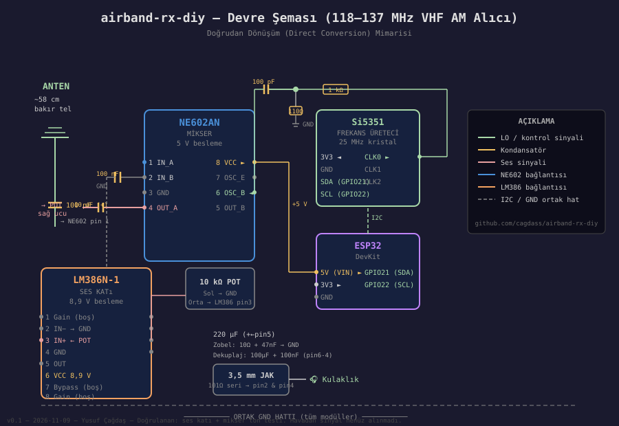

# ✈️ airband-rx-diy

**DIY VHF Havacılık Bandı Alıcısı — 118–137 MHz**

Uçak haberleşmesini dinlemek için sıfırdan yapılmış bir doğrudan dönüşüm (direct-conversion) alıcısı.  
NE602AN mikser, Si5351 yerel osilatör ve LM386 ses katından oluşur.  
Pahalı SDR donanımı gerekmez — parçaların büyük çoğunluğu elektronik marketlerden veya çevrimiçi olarak temin edilebilir.

---

## Mimari

```
         ┌──────────────────────────────────────────────────────────┐
         │                                                          │
  ANTEN  │  100 pF   ┌──────────┐  10 µF  ┌─────────┐  101 Ω     │
 ~58 cm ─┼──┤├───────► NE602AN  ├──┤├─────► LM386   ├───┤├────── 🎧│
         │           │  MİKSER  │         │  SES    │            │
         │   ┌───────► (pin 6)  │         │  KATI   │            │
         │   │       └──────────┘         └─────────┘            │
         │  110 Ω                                                  │
         │   │       ┌──────────┐  I2C    ┌─────────┐            │
         │  1 kΩ    │ Si5351   ◄──────────┤  ESP32  │            │
         │   │       │  CLK0    │         │ GPIO21  │            │
         │  CLK0────►│ 118–137  │         │ GPIO22  │            │
         │           │  MHz     │         └─────────┘            │
         │           └──────────┘                                  │
         └──────────────────────────────────────────────────────────┘
```

**Çalışma prensibi:** NE602AN, anten sinyalini (uçak radyosu) Si5351'den gelen LO sinyaliyle çarpar.  
Çıkışta oluşan fark frekansı (ses aralığında ~0–3 kHz) LM386 ile yükseltilip kulaklığa verilir.  
Bu AM alıma olanak tanır — geleneksel süperheterodine devresinden çok daha basit.

---

## Devre Şeması



---

## Parça Listesi

| Bileşen | Değer / Model | Notlar |
|---|---|---|
| Mikser | NE602AN / SA602 / SA612 | DIP-8; aynı chip, farklı markalar |
| Frekans üreteci | Si5351 modülü | 25 MHz kristalli; 8 kHz–160 MHz |
| Ses katı | LM386N-1 | DIP-8; 8 Ω çıkış |
| Mikrodenetleyici | ESP32 DevKit | I2C üzerinden Si5351 kontrolü |
| Kuplaj kondesatörü (anten) | 100 pF | 101 yazan seramik |
| LO kuplajı | 100 pF | 101 yazan seramik |
| Pin 2 bypass | 100 nF | NE602 RF girişi dengesi |
| NE602 çıkış kuplajı | 10 µF | Elektrolitik, + pin 4 tarafında |
| LM386 çıkış kuplajı | 220 µF | Elektrolitik, + pin 5 tarafında |
| LM386 besleme dekuplajı | 100 µF + 100 nF | **Kritik — ısınma sorununun çözümü** |
| Zobel ağı | 10 Ω + 47 nF | LM386 pin 5'ten GND'ye |
| LO zayıflatıcısı | 1 kΩ + 110 Ω | 2 × 56 Ω seri = 110 Ω kullanıldı |
| Ses seviyesi | 10 kΩ potansiyometre | — |
| Kulaklık direnci | 101 Ω × 2 | Her kanal için ayrı |
| Anten | ~58 cm bakır tel | 127,5 MHz için λ/4 monopol |

---

## Firmware

Üç aşamalı test süreci:

### 1. `firmware/si5351_test/`
Si5351 modülünün çalışıp çalışmadığını doğrular. CLK0'dan 100 MHz üretir.

### 2. `firmware/mikser_test/`
Mikseri test eder. CLK0 ve CLK1 arasında 1 kHz fark koyar → kulaklıkta 1 kHz ton duyulur.

### 3. `firmware/alici_lo/`
Ana alıcı kodu. Serial Monitor üzerinden frekans ayarlanır:

```
Komutlar:
  127.500   → frekansı doğrudan gir (MHz)
  +         → 100 Hz arttır
  -         → 100 Hz azalt
  ++        → 1 kHz arttır
  --        → 1 kHz azalt
```

### Gerekli Kütüphane
Arduino IDE → Library Manager → `Si5351` by **Etherkit** (Jason Milldrum)

---

## Kurulum

1. Devreyi [`docs/devre-baglantilari.md`](docs/devre-baglantilari.md) belgesindeki tablolara göre kur.
2. Önce `si5351_test.ino` yükle — `Si5351 bulundu.` mesajını gör.
3. Sonra `mikser_test.ino` yükle — kulaklıkta ince bir ton duyulmalı.
4. Son olarak `alici_lo.ino` yükle. Frekansı 118–137 MHz aralığında tara.

---

## Doğrulanmış Testler

| Test | Durum |
|---|---|
| LM386 ısınma sorunu çözüldü | ✅ 29–30°C |
| Si5351 FM radyo bant testi | ✅ Çalan müzik kesildi |
| NE602AN mikser ton testi (1 kHz) | ✅ Ton duyuldu, frekans değişince ton değişti |
| Gerçek uçak sinyali alımı | ⏳ Henüz test edilmedi |

---

## Belgeler

- [`docs/devre-baglantilari.md`](docs/devre-baglantilari.md) — Tüm pin bağlantıları ve değerler
- [`docs/sorun-giderme.md`](docs/sorun-giderme.md) — Karşılaşılan sorunlar ve çözümleri

---

## Lisans

MIT — ayrıntılar için [`LICENSE`](LICENSE) dosyasına bakın.

---

## Uyarı

Bu proje eğitim amaçlıdır. Havacılık frekanslarında **sadece alım** yapılabilir; iletim yapmak yasal değildir ve tehlikelidir. Türkiye'de havacılık frekanslarında yayın yapmak Bilgi Teknolojileri ve İletişim Kurumu (BTK) lisansı gerektirir.
